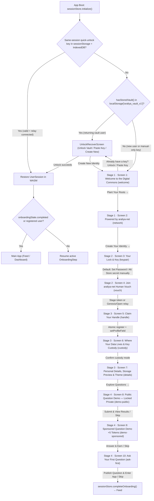

# `userx` 10-Screen Onboarding Flow — Implementation Plan

**Status:** Implemented  
**Target Workspace:** `/data/p2p/userx` (SvelteKit 2 + Svelte 5 + Tailwind v4 + `$wasm` `araliya-net-wasm`)  
**Companion Seed File (Optional Relay Bootstrap):** [seed-qna.json](file:///data/p2p/userx/seed-qna.json) (tracked in `userx`; mirrored at `/data/p2p/araliya-net/data/seed_qna.json` for `araliya-net-relay --seed-qna`)  
**Related Docs:**
- [01-wasm-client-architecture.md](file:///data/p2p/userx/docs/plans/01-wasm-client-architecture.md)
- [userx_main.md](file:///data/p2p/docs/userx_main.md)
- [02-identity-auth-and-client.md](file:///data/p2p/araliya-net/docs/02-identity-auth-and-client.md)

---

## 1. Architectural Scope & Protocol Boundary

This milestone replaces the current 5-step alpha onboarding (`LoginVouchScreen` → `ManifestoScreen` → `UsernameScreen` → `PersonalDetailsScreen` → `ThemePickerScreen`) with a cohesive **10-screen, 4-stage onboarding flow** aligned with `araliya-net`'s Ed25519 identity model, local-first key custody, human vouch admission, public/private data ledger, and Q&A mechanics.

### Protocol Boundary Decision (Zero Rust / WASM Changes Required)

All required cryptographic, storage, admission, and Q&A primitives already exist in `$wasm` (`vendor/araliya-net-wasm/araliya_net_wasm.d.ts`):
- **Identity & Local Vault:** `generateKeypair`, `createKeyVault`, `unlockWithVault`, `unlockWithSecretKey`, `unlockWithSecretKeyBytes`, `exportRecoveryKey`, `importRecoveryKey`, `exportRecoveryPayload`.
- **Admission & Profile:** `registerWithVouchCard`, `registerUser`, `updateProfile`, `getUserByPubkey`, `setProfileField`, `getPrivateProfileFields`, `completeOnboardingStep`, `getOnboardingState`.
- **Q&A:** `answerLeafHex`, `qnaListQuestions`, `qnaGetResults`, `qnaSetAnswerVisibility`, `qnaListMyPrivateResponses`, and **`qnaCreateQuestion`**.

Because `araliya-net-qna` (`crates/araliya-net-qna/src/types.rs`) does not yet have protocol fields for `reference_url`, sponsorship flags, or token balances:
- **Stage 4 Sponsored badges, `+5 Tokens`, `Reference Link`, and `FREE (First Question Credit)`** are implemented strictly as **onboarding UI walkthrough state** (persisted locally in `localStorage['userx_ui_state_v2']`).
- **Screen 10 (`Ask Your First Question`)** publishes a **real** public question (`text` + `answers`, `multiple: false`, `scope: 'pub'`) to the connected relay via `AraliyaWasmApp.qnaCreateQuestion`.

---

## 2. High-Level Flow & Entry Routing



---

## 3. Key Design Resolutions

### 3.1 Screen 3 → Screen 6 Dynamic Key Custody (`Store secret manually` link)

Screen 3 (**Your Lock & Key**) keeps the password flow first by default while offering an explicit **`Store secret manually instead →`** link for users who do not want an encrypted local vault stored in `localStorage`.

1. **Default Path (`custodyMode = 'browser-encrypted'`):**
   - On mount, Screen 3 generates a fresh Ed25519 keypair (`araliyaService.generateKeypair()`) and checksummed recovery key (`araliyaService.exportRecoveryKey(kp.secretKey)` → `araliya-recovery:v1:...`).
   - Displays **Public Key (`Lock`)** with `[Copy]` and masked **Private Key (`Key`)** with `[Reveal]` and `[Copy]`.
   - Prompts for **Local Password** (`minlength={8}`) + **Confirm Password**.
   - On `[Continue →]`: creates `EncryptedKeyVault` (`araliyaService.createVaultJson`), saves `araliya_vault_v1` in `localStorage`, unlocks WASM (`unlockWithSecretKey`), saves tab-scoped quick-unlock (`saveQuickUnlockSecret`), sets `custodyMode = 'browser-encrypted'`, and advances to Screen 4.
2. **Manual Secret Path (`Store secret manually instead →` toggle on Screen 3):**
   - Clicking the link switches Screen 3 inline to **Manual Secret Mode**:
     - Hides the password inputs.
     - Reveals/highlights the checksummed `araliya-recovery:v1:...` key with `[Copy Private Key]`.
     - Requires checking `[✓] I saved my Private Key somewhere safe — I will paste it each session`.
   - On `[Continue →]`: unlocks WASM in memory (`unlockWithSecretKey`) and saves only the ephemeral tab quick-unlock token (`saveQuickUnlockSecret` in `sessionStorage` + non-extractable WebCrypto key in `IndexedDB`), **without** writing `araliya_vault_v1` to `localStorage`. Sets `custodyMode = 'manual-no-store'`.
   - *Note:* If the user clicks `← Back` from Screen 4 to Screen 3, the already-unlocked in-memory identity and keypair are preserved rather than regenerated.
3. **Screen 6 (`Where Your Data Lives & Key Custody`) Adaptation:**
   - Displays connected relay metadata (`relayStatus.endpointId`, `relayStatus.source`, `relayStatus.admissionPolicy`) and zero-knowledge explanation (`XChaCha20-Poly1305` client-side encryption before hitting the relay).
   - **When `custodyMode === 'browser-encrypted'`:** Presents the 3 custody options:
     1. **Keep encrypted in this browser** *(Default — fast unlock with your password)*
     2. **Save in a Password Vault & wipe from browser** *(Prompts `[Copy Private Key / Recovery Token]` + required confirmation `[✓] I saved my key in a password manager` before calling `deleteStoredVault()` on `[Next →]`)*
     3. **Do not store — I will copy and paste it every session** *(Prompts `[Copy Private Key]` + required confirmation `[✓] I backed up my key` before calling `deleteStoredVault()` on `[Next →]`)*
   - **When `custodyMode === 'manual-no-store'`:** Highlights **Option 3 (Manual Session-Only Custody)** as active (*"No encrypted vault is stored in this browser"* + `[Copy Private Key]`), while offering an inline *"Switch to browser password vault instead"* drawer so the user can set a password and opt into Option 1 if they change their mind.

### 3.2 Screen 4 → Screen 5 Vouch Staging vs. Atomic Relay Admission

In `araliya-net-store` (`crates/araliya-net-store/src/store/table.rs`), `RegisterAdmittedUser` checks `initial_vouch.subject_pk == profile.user_pubkey` and commits `username` + `initial_vouch` in a single atomic transaction (`registerWithVouchCard(username, displayName, vouchToken)`). Therefore:
- **Screen 4 stages and validates** the vouch token without registering a blank username prematurely.
- **Screen 5 commits** registration on the relay when the user claims their `@username`.

Screen 4 handles both states:
- **URL Invite Capture:** On initialization, `sessionStore` checks `window.location.search` / hash for `?vouch=<token>` (and optional `&inviter=<handle>`) and stores it in `pendingVouchToken` / `pendingVouchInviter`.
- **State A — Auto-Genesis or Invite Present:**
  - If `pendingVouchToken` is already set, displays the token status and resolves the voucher handle when possible (from `cert.voucher_pk` on JSON `VouchCard`s via `getUserByPubkey`, or `?inviter=` hint; `araliya-vouch-card:v1:...` tokens are `postcard`-encoded binary payloads passed verbatim to WASM).
  - If no `pendingVouchToken` exists and `relayStatus.httpAvailable && relayStatus.genesisMode`, Screen 4 automatically requests a Genesis `VouchCard` for `identity.userPubkey` via `POST /genesis/vouch` and displays: *"You have been accepted to the network by the recommendation of `@genesis`!"*
- **State B — No Invite Link Yet:**
  - Provides `[Paste Vouch Token]` (`araliya-vouch-card:v1:...` or JSON) with format validation.
  - Provides `[Copy Vouch Request for Relay Maintainer]`, which copies a formatted request payload containing the user's `userPubkey` (plus a local `--genesis` `curl` snippet when applicable) so an existing member or relay maintainer can mint a `VouchCard` bound to that `subject_pk`.
  - When `relayStatus.admissionPolicy === 'open'`, shows an explicit `"Open Relay — Continue without vouch token →"` path.

### 3.3 Screen 5 Privacy-Preserving `[Make Private]` Handle Registration

The relay `users` table requires a unique plaintext `username` during `RegisterAdmittedUser` / `RegisterUser`. To honor the **`[Make Private]`** switch without breaking relay registration:
- **Visibility = `🌐 Public` (Default):**
  - Calls `registerWithVouchCard` / `registerUser` with `cleanedUsername`.
  - Calls `setProfileField('username', cleanedUsername, true)` (writes both `profile_fields` and public projection).
- **Visibility = `🔒 Private` (`[Make Private]`):**
  - Registers a deterministic pseudonymous directory handle `gardener_${pubkeyHex.slice(0, 8)}` (fallback if taken: `gardener_${pubkeyHex.slice(0, 12)}`) in the public `users` table so relay admission succeeds without exposing the user's chosen handle publicly.
  - Calls `setProfileField('username', cleanedUsername, false)` so the user's chosen `@username` is stored **only** in encrypted `UserPrivate` `profile_fields`.
  - If the user already registered earlier in the session and returns to Screen 5, updates `profile_fields` and `updateProfile` accordingly (respecting privacy when switching back to Private).

### 3.4 Screen 7 All-Optional Details, Live Namespace Preview & `Forest Dark` Default Theme

- **All Details Optional:** Relax `realName.required` from `true` to `false` in `ledger.svelte.ts` (`createInitialProfile()`). **Name**, **Date of Birth**, and **Pronouns** are all optional and default to `visibility: 'private'`.
- **Live Relay Storage Preview:** Displays a reactive monospace tree reflecting the user's actual key and Screen 5/7 choices:
  ```text
  Namespace: pub:<pk8> / priv:<pk8>
  ├── /public   → { "username": "alice" | "gardener_<pk8>", "vouched_by": "@genesis" }
  └── /private  → 🔒 [XChaCha20-Poly1305 · encrypted on device]
  ```
- **`Forest Dark` Default Theme:**
  - Add `forest` (**`Forest Dark`**) to `src/lib/config/themes.config.ts` and set `DEFAULT_THEME_ID = 'forest'`.
  - Palette tokens (`Forest Dark`): deep mossy forest background (`#08120e`), dark pine card (`#0f1f18`), botanical emerald primary (`#34d399`), warm golden amber accent (`#f59e0b`), soft sage foreground (`#ecfdf5`), subtle aura/organic border styling, keeping `araliya`, `obsidian`, `solaris`, and `monolith` selectable via the inline `[Change Theme]` drawer/sheet.

### 3.5 Stage 4 Default Intro Questions (Screens 8–9) & First Question Creation (Screen 10)

Inspection of `/data/p2p/araliya-net/data/araliya-relay/store.db` confirms the `questions` table is empty by default unless `--seed-qna <PATH>` is passed on relay startup. To guarantee Screens 8–9 **always** display the two default walkthrough questions reliably:

1. **Dual Canonical Source (`onboarding.questions.ts` + `seed_qna.json`):**
   - Create `src/lib/config/onboarding.questions.ts` containing the canonical default Question #1 and Question #2 definitions.
   - Create `/data/p2p/araliya-net/data/seed_qna.json` matching `SeedQuestionEntry` (`crates/araliya-net-relay/src/lib.rs`: `text`, `answers`, `multiple`) so relays started with `--seed-qna data/seed_qna.json` seed the exact same content-addressed `qa-cid/v1` rows.
2. **Screen 8 — Question #1 (`Pepsi or Coke?`):**
   - Choices: `Pepsi`, `Coke`, `No preference`.
   - Answer mode badge: **`🔒 Private · Locked for this intro`** (no public-toggle switch on Screen 8).
   - **Submission behavior:** Checks `ledgerStore.questions` for a matching question by CID/text on the connected relay.
     - If present on relay: calls `ledgerStore.submitAnswer(matchedQuestion, selectedOption.id, false)` → genuinely encrypts and persists the choice to `qna_private_responses` on the relay via `qnaSetAnswerVisibility(..., false)`.
     - Regardless of whether the relay was seeded, displays the result breakdown (live relay counts merged with/falling back to the baseline `41% / 47% / 12%` preview) plus a clear privacy note explaining that private answers stay encrypted and never increment public tallies.
   - Includes `[Skip Question]` and `[Submit & View Results →]` → `[Continue →]`.
3. **Screen 9 — Question #2 (`We don't need nukes.` — UI Walkthrough Preview):**
   - Header badges: `⚡ Sponsored (+5 Tokens)` · `🔗 External Context`.
   - Choices: `Agree`, `Disagree` + clickable `📎 Read background link ↗` modal/preview.
   - Clicking `[Answer & Earn +5 Tokens →]` increments `sessionStore.demoTokenBalance` (`+5`, persisted in walkthrough UI state) and advances (or shows a quick earned toast); `[Skip]` advances without adding tokens.
4. **Screen 10 — `Ask Your First Question` (Real Relay Publish):**
   - Question prompt input + dynamic answer choice list (minimum 2, up to 6 via `[+ Add another choice]`, client validation matching `answers_root`: >= 2 non-empty, unique trimmed choices).
   - Optional `Reference Link` input & pre-checked `[✓] Make this a sponsored question — ~~50 Tokens~~ FREE (First Question Credit)` (both held as onboarding walkthrough UI state; marks `firstQuestionCreditUsed = true` on publish).
   - `[Publish Question & Enter App →]` calls `ledgerStore.createQuestion(text, answers)` (`araliyaService.createPublicQuestion` → `AraliyaWasmApp.qnaCreateQuestion`), reloads questions from the relay (`loadQuestionsFromRelay`), and completes onboarding (`sessionStore.completeOnboarding()`).
   - Secondary `[Skip & Enter App →]` exits directly to the main feed without publishing.

---

## 4. Screen-by-Screen Component & State Map

| Stage / Screen | `OnboardingStep` | Component Path (`src/lib/components/onboarding/`) | Primary Actions & Store/WASM Calls | Back / Secondary Navigation |
| :--- | :--- | :--- | :--- | :--- |
| **Returning Gate** | `unlock` *(when `!isLoggedIn && hasVault`)* | `UnlockRecoverScreen.svelte` | `sessionStore.unlockWithPassword`, `recoverFromRecoveryKey`, `unlockWithRawSecret` | Switch to *"Paste Recovery / Private Key"* or *"Create New Identity"* (`welcome`) |
| **Header Control** | *(Shared)* | `RelayStatusPill.svelte` | `sessionStore.refreshRelayStatus`, `setManualRelayOverride`, `clearManualRelayOverride` | Toggle Direct Iroh `EndpointId` / relay URLs override drawer |
| **Stage 1 · Screen 1** | `'welcome'` | `WelcomeCommonsScreen.svelte` | `[Plant Your Roots →]` → `setOnboardingStep('network')` | `"Already have a key? Unlock / Paste Key"` → `UnlockRecoverScreen` |
| **Stage 1 · Screen 2** | `'network'` | `PoweredByAraliyaScreen.svelte` | `[Create Your Identity →]` → `setOnboardingStep('keypair')` | `← Back` → `'welcome'` |
| **Stage 2 · Screen 3** | `'keypair'` | `KeypairCustodyScreen.svelte` | `generateKeypair`, `exportRecoveryKey`; Default: `createVaultJson` + `unlockWithSecretKey`; Manual link: `unlockWithSecretKey` + `saveQuickUnlockSecret` only | `← Back` → `'network'`; inline toggle `Store secret manually instead →` |
| **Stage 2 · Screen 4** | `'vouch'` | `HumanVouchScreen.svelte` | Auto `requestGenesisVouch` (if HTTP `--genesis`), `inspectVouchCard`, `getUserByPubkey`, stage `pendingVouchToken` | `← Back` → `'keypair'`; copy Vouch Request (`userPubkey`) or continue if `open` policy |
| **Stage 3 · Screen 5** | `'handle'` | `ClaimHandleScreen.svelte` | `ledgerStore.saveUsername(handle, keepPublic, pendingVouchToken)` (`registerWithVouchCard` / `registerUser` + `setProfileField`); `advanceOnboardingStep('custody')` | `← Back` → `'vouch'` |
| **Stage 3 · Screen 6** | `'custody'` | `StorageCustodyScreen.svelte` | `sessionStore.applyCustodySelection(mode, password?)` (`deleteStoredVault` for options 2/3 with backup check, or `createVaultJson` if upgrading from manual); `advanceOnboardingStep('details')` | `← Back` → `'handle'` |
| **Stage 3 · Screen 7** | `'details'` | `PersonalDetailsPreviewScreen.svelte` | Optional `Name`, `DoB`, `Pronouns` → `ledgerStore.saveIdentityDetails(...)`; live `/public` & `/private` tree; `themeStore.setTheme(...)` (`Forest Dark` default); `advanceOnboardingStep('demo-public')` | `← Back` → `'custody'` |
| **Stage 4 · Screen 8** | `'demo-public'` | `PublicQuestionDemoScreen.svelte` | Locked `🔒 Private`; if question exists on relay, `ledgerStore.submitAnswer(..., false)` (`qnaSetAnswerVisibility`); reveal results + privacy note; `advanceOnboardingStep('demo-sponsored')` | `← Back` → `'details'`; `[Skip Question]` |
| **Stage 4 · Screen 9** | `'demo-sponsored'` | `SponsoredQuestionDemoScreen.svelte` | Preview external link; `[Answer & Earn +5 Tokens →]` increments `demoTokenBalance` (`+5`); `advanceOnboardingStep('ask-first')` | `← Back` → `'demo-public'`; `[Skip]` |
| **Stage 4 · Screen 10** | `'ask-first'` | `AskFirstQuestionScreen.svelte` | `ledgerStore.createQuestion(text, choices)` (`qnaCreateQuestion`); marks `firstQuestionCreditUsed`; `sessionStore.completeOnboarding()` → `'feed'` | `← Back` → `'demo-sponsored'`; `[Skip & Enter App →]` |

---

## 5. File-by-File Implementation Plan (Ordered Vertical Slices)

### Slice 1 — Types, `Forest Dark` Theme & Default Onboarding Questions
1. **`src/lib/types/index.ts`**
   - Update `OnboardingStep` to:
     `'unlock' | 'welcome' | 'network' | 'keypair' | 'vouch' | 'handle' | 'custody' | 'details' | 'demo-public' | 'demo-sponsored' | 'ask-first' | 'feed'`.
   - Add `export type KeyCustodyMode = 'browser-encrypted' | 'password-vault-wiped' | 'manual-no-store';`
   - Update `ThemeId` to `'forest' | 'araliya' | 'obsidian' | 'solaris' | 'monolith'`.
   - Add `OnboardingDemoQuestion` and `VouchInspection` interfaces.
2. **`src/lib/config/themes.config.ts` & `src/app.css`**
   - Add **`Forest Dark`** (`id: 'forest'`) as the first entry in `THEMES` and set `DEFAULT_THEME_ID: ThemeId = 'forest'`.
   - Update `:root` fallback CSS variables in `src/app.css` to match `Forest Dark` so there is zero flash of cosmic indigo on first paint before hydration.
3. **`src/lib/config/onboarding.questions.ts` *(new)* & `/data/p2p/araliya-net/data/seed_qna.json` *(new)***
   - Define `DEFAULT_PUBLIC_DEMO_QUESTION` (`"Pepsi or Coke?"`, options `["Pepsi", "Coke", "No preference"]`, baseline preview counts `{ Pepsi: 582, Coke: 667, "No preference": 171 }` totaling `1,420`) and `DEFAULT_SPONSORED_DEMO_QUESTION` (`"We don't need nukes."`, options `["Agree", "Disagree"]`, reward `5`, reference URL/summary).
   - Mirror both questions in `/data/p2p/araliya-net/data/seed_qna.json` for optional relay seeding via `--seed-qna`.

### Slice 2 — WASM Service & Reactive Stores
4. **`src/lib/services/araliya.service.ts`**
   - Add `createPublicQuestion(text: string, answers: string[]): Promise<{ cid: string; created: boolean }>` calling `this.requireApp().qnaCreateQuestion({ text, answers, multiple: false, scope: 'pub' })` and normalizing `item.cid` via `bytesToHex`.
   - Add `inspectVouchToken(tokenOrJson: string)`: validates `araliya-vouch-card:v1:<base64url>` prefix/encoding or parses JSON `VouchCard` (`cert.subject_pk`, `cert.voucher_pk`), returning structured validity & voucher pubkey metadata when inspectable.
5. **`src/lib/stores/session.svelte.ts`**
   - Add reactive state: `custodyMode`, `pendingDraftKeypair` (held in memory only across Screens 3–4 until custody/vouch completes), `pendingVouchInviter`, `demoTokenBalance`, `firstQuestionCreditUsed`, and `wantsManualUnlock` (allows users on Screen 1 with no vault to jump to `UnlockRecoverScreen`).
   - Capture `?vouch=` and `?inviter=` query/hash params during `initialize()` and clean the URL bar cleanly if needed.
   - Implement legacy step mapping inside `restoreUiState()` (`login` → `'unlock'`, `manifesto` → `'welcome'`, `username` → `'handle'`, `identity` → `'details'`, `theme` → `'details'`) so existing browser `localStorage` state upgrades cleanly.
   - Add `createEncryptedAccount(kp, password)`, `createManualAccount(kp)` (unlocks WASM + tab quick-unlock without saving `araliya_vault_v1`), `unlockWithRecoveryOrSecret(input, password?)`, `applyCustodySelection(mode, password?)`, `awardDemoTokens(amount)`, and `markFirstQuestionCreditUsed()`.
6. **`src/lib/stores/ledger.svelte.ts`**
   - Change `realName.required` to `false` in `createInitialProfile()`.
   - Update `saveUsername(username, keepPublic, pendingVouchToken)` so when `keepPublic === false`, it registers `gardener_${pkHex.slice(0, 8)}` (retrying with `12` chars on conflict) in the relay `users` directory while storing the user's real `@username` in encrypted `profile_fields` (`isPublic = false`).
   - Expose `createQuestion(text: string, answers: string[])` which calls `araliyaService.createPublicQuestion`, appends/reloads `questions` via `loadQuestionsFromRelay`, and returns `{ cid, created }`.

### Slice 3 — Entry Gate & Stage 1–2 Screens (Screens 1–4 + Unlock)
7. **`src/lib/components/onboarding/RelayStatusPill.svelte` *(new)***
   - Extract the relay connectivity indicator and Direct Iroh override popover from `LoginVouchScreen.svelte` into a compact reusable header component used across `UnlockRecoverScreen` and Stage 1–2 onboarding headers.
8. **`src/lib/components/onboarding/UnlockRecoverScreen.svelte` *(new)***
   - Handles returning `Unlock` (when `hasVault`), `Paste Key / Recover` (`araliya-recovery:v1:...` or raw base64 secret key, with optional *"Save as local encrypted vault"* toggle vs. session-only unlock), and a `"New here? Start onboarding"` button routing to Screen 1 (`'welcome'`).
9. **`src/lib/components/onboarding/WelcomeCommonsScreen.svelte` *(new — Screen 1)***
   - Stage 1 copy (*"Digital Gardeners: Own your data, your attention, and your work."*), `[Plant Your Roots →]` CTA, `"Already have a key? Unlock / Paste Key"` action, and `RelayStatusPill`.
10. **`src/lib/components/onboarding/PoweredByAraliyaScreen.svelte` *(new — Screen 2)***
    - Explains `araliya-net` + `iroh` peer storage relays, live connection badge, `← Back`, and `[Create Your Identity →]`.
11. **`src/lib/components/onboarding/KeypairCustodyScreen.svelte` *(new — Screen 3)***
    - Shows generated Public Key (`Lock`) + masked Private Recovery Key (`Key`, `[Reveal]`, `[Copy]`).
    - Default: Password + Confirm Password inputs (`minlength={8}`), plus small **`Store secret manually instead →`** link.
    - Manual mode: hides password inputs, highlights key backup copy + mandatory backup acknowledgment checkbox, and switches cleanly back via `"Encrypt with a local password instead"`.
12. **`src/lib/components/onboarding/HumanVouchScreen.svelte` *(new — Screen 4)***
    - Handles State A (pre-filled `?vouch=` invite or automatic `--genesis` vouch fetch with voucher identity lookup) and State B (`[Paste Vouch Token]` + `[Copy Vouch Request for Relay Maintainer]` containing `userPubkey`, plus open-relay fallback when `admissionPolicy === 'open'`).

### Slice 4 — Stage 3–4 Screens (Screens 5–10), Routing & Cleanup
13. **`src/lib/components/onboarding/ClaimHandleScreen.svelte` *(new — Screen 5)***
    - `@username` input + `🌐 Public` / `🔒 Private` toggle (`[Make Private]`), clear explanation of pseudonymous `gardener_<pk8>` relay admission when private, and atomic `saveUsername` on `[Next →]`.
14. **`src/lib/components/onboarding/StorageCustodyScreen.svelte` *(new — Screen 6)***
    - Displays connected relay + encryption-at-rest copy and the 3 custody options, adapting smoothly whether the user arrived with `'browser-encrypted'` or `'manual-no-store'` from Screen 3 and enforcing a backup confirmation check before wiping `araliya_vault_v1`.
15. **`src/lib/components/onboarding/PersonalDetailsPreviewScreen.svelte` *(new — Screen 7)***
    - Optional `Name`, `Date of Birth`, `Pronouns` inputs (all private by default), live `/public` & `/private` relay tree preview updating reactively, and `Selected Theme: Forest Dark` with inline `[Change Theme]` picker.
16. **`src/lib/components/onboarding/PublicQuestionDemoScreen.svelte` *(new — Screen 8)***
    - Renders `"Pepsi or Coke?"` with locked `🔒 Private` answer mode, submits privately to relay if the seeded CID exists (or local walkthrough state otherwise), reveals the result bars + privacy callout, and advances.
17. **`src/lib/components/onboarding/SponsoredQuestionDemoScreen.svelte` *(new — Screen 9)***
    - Renders `"We don't need nukes."` with `⚡ Sponsored (+5 Tokens)`, `🔗 External Context` reader drawer/link, `[Skip]`, and `[Answer & Earn +5 Tokens →]`.
18. **`src/lib/components/onboarding/AskFirstQuestionScreen.svelte` *(new — Screen 10)***
    - Question input, dynamic 2–6 choice builder, optional Reference Link (walkthrough UI), pre-checked `FREE (First Question Credit)` sponsorship toggle (walkthrough UI), `[Publish Question & Enter App →]` (real `qnaCreateQuestion`), and `[Skip & Enter App →]`.
19. **`src/routes/+page.svelte`, `src/lib/components/dashboard/UserDashboard.svelte`, & Cleanup**
    - Update `+page.svelte` step switch to route `!isLoggedIn` between `'unlock'` and `'welcome'`–`'vouch'` as appropriate, and authenticated steps `'handle'`–`'ask-first'` to their new screens.
    - Update `UserDashboard.svelte`: `"Revisit Onboarding"` restarts at `'welcome'`, display custody status & `demoTokenBalance` in Settings.
    - Remove obsolete alpha onboarding components (`LoginVouchScreen.svelte`, `ManifestoScreen.svelte`, `UsernameScreen.svelte`, `PersonalDetailsScreen.svelte`, `ThemePickerScreen.svelte`) once all imports are migrated.

20. **`vite.config.ts` & `src/lib/services/araliya.service.ts` (WASM Dev Serving Guard)**
    - Added `./vendor` (`fileURLToPath(new URL('./vendor', import.meta.url))`) to `server.fs.allow` so `vite dev` serves `/vendor/araliya-net-wasm/araliya_net_wasm.js` and `araliya_net_wasm_bg.wasm` alongside `@sveltejs/kit/vite`'s default allow-list.
    - Updated `ensureWasm()` in `araliya.service.ts` to clear `this.wasmPromise = null` on failure so transient fetch errors do not permanently wedge WASM loading.

---

## 6. Verification Matrix (For Implementation Phase)

### Static & Build Checks
- Run `pnpm --dir /data/p2p/userx run check` (`svelte-kit sync && svelte-check`) — passed with `0` errors and `0` warnings.
- Run `pnpm --dir /data/p2p/userx run build` — passed (`@sveltejs/adapter-cloudflare`).
- Verify `vite dev` middleware serves `/vendor/araliya-net-wasm/araliya_net_wasm.js` and `/vendor/araliya-net-wasm/araliya_net_wasm_bg.wasm` with HTTP `200` — passed.

### End-to-End Functional Scenarios
1. **Default Password Onboarding (`--genesis` relay, seeded & unseeded):**
   - Complete Screens 1–10 → verify `araliya_vault_v1` exists in `localStorage`, `@handle` is registered on relay, Screen 8 writes an encrypted private response (when seeded) without bumping public tally, Screen 9 awards `+5` walkthrough tokens, and Screen 10 publishes a real `pub` question visible immediately in the Feed.
2. **Manual Secret Path (`Store secret manually` on Screen 3):**
   - Toggle manual mode on Screen 3, verify `localStorage.getItem('araliya_vault_v1') === null`, verify Screen 6 shows Option 3 active, confirm same-tab reload quick-unlocks, and verify closing/reopening a fresh browser session prompts to paste key on `UnlockRecoverScreen`.
3. **Private Handle Path (`[Make Private]` on Screen 5):**
   - Register with `[Make Private]`, inspect relay `users` table (shows `gardener_<pk8>`) and `encrypted_rows` (`profile_fields` holds encrypted real `@username`), and verify Screen 7 tree preview reflects the split.
4. **Custody Wipe Guard (Screen 6 Options 2 & 3):**
   - Switch from browser password vault to Option 2 or 3 on Screen 6, verify confirmation checkbox is required before `deleteStoredVault()` executes, and verify `UnlockRecoverScreen` reflects the wiped vault after locking.
