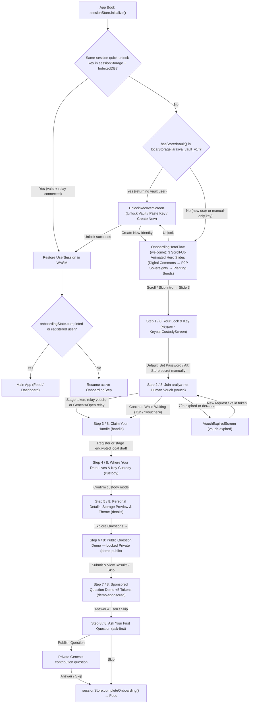

# `userx` 10-Screen Onboarding Flow — Implementation Plan

**Status:** Implemented  
**Target Workspace:** `/data/p2p/userx` (SvelteKit 2 + Svelte 5 + Tailwind v4 + `$wasm` `araliya-net-wasm`)  
**Canonical Onboarding Manifest:** [`araliya-net/data/seed_qna.json`](file:///data/p2p/araliya-net/data/seed_qna.json), published by the relay as the public doc `onboarding/manifest-v1` and loaded by `userx` over Iroh.
**Related Docs:**
- [01-wasm-client-architecture.md](file:///data/p2p/userx/docs/plans/01-wasm-client-architecture.md)
- [userx_main.md](file:///data/p2p/docs/userx_main.md)
- [02-identity-auth-and-client.md](file:///data/p2p/araliya-net/docs/02-identity-auth-and-client.md)

---

## 1. Architectural Scope & Protocol Boundary

This milestone replaces the current 5-step alpha onboarding (`LoginVouchScreen` → `ManifestoScreen` → `UsernameScreen` → `PersonalDetailsScreen` → `ThemePickerScreen`) with a cohesive **10-screen, 4-stage onboarding flow** aligned with `araliya-net`'s Ed25519 identity model, local-first key custody, human vouch admission, public/private data ledger, and Q&A mechanics.

### Protocol Boundary & Peer-Vouch Bindings

All required cryptographic, storage, admission, peer-vouching, and Q&A primitives live in `$wasm` (`vendor/araliya-net-wasm/araliya_net_wasm.d.ts`):
- **Identity & Local Vault:** `generateKeypair`, `createKeyVault`, `unlockWithVault`, `unlockWithSecretKey`, `unlockWithSecretKeyBytes`, `exportRecoveryKey`, `importRecoveryKey`, `exportRecoveryPayload`, `sealLocalDraft`, `unsealLocalDraft`.
- **Admission, Peer Vouch & Profile:** `decodeVouchCard`, `registerWithVouchCard`, `registerWithSubmittedVouch`, `checkInitialVouch`, `listVouches`, `issueVouchCard`, `submitVouchCard`, `submitVouchRequest`, `listIncomingVouchRequests`, `listMyVouchRequests`, `dismissVouchRequest`, `registerUser`, `updateProfile`, `getUserByPubkey`, `getUserByUsername`, `setProfileField`, `getPrivateProfileFields`, `completeOnboardingStep`, `getOnboardingState`.
- **Q&A:** `answerLeafHex`, `qnaListQuestions`, `qnaGetResults`, `qnaSetAnswerVisibility`, `qnaListMyPrivateResponses`, and **`qnaCreateQuestion`**.

Because `araliya-net-qna` (`crates/araliya-net-qna/src/types.rs`) does not yet have protocol fields for `reference_url`, sponsorship flags, or token balances:
- **Stage 4 Sponsored badges, `+5 Tokens`, `Reference Link`, and `FREE (First Question Credit)`** are implemented strictly as **onboarding UI walkthrough state** (persisted locally in `localStorage['userx_ui_state_v2']`).
- **Screen 10 (`Ask Your First Question`)** publishes a **real** public question (`text` + `answers`, `multiple: false`, `scope: 'pub'`) to the connected relay via `AraliyaWasmApp.qnaCreateQuestion`.

---

## 2. High-Level Flow & Entry Routing



---

## 3. Key Design Resolutions

### 3.1 Screen 3 → Screen 6 Dynamic Key Custody (`Store secret manually` link)

Screen 3 (**Your Lock & Key**) keeps the password flow first by default while offering an explicit **`Store secret manually instead →`** link for users who do not want an encrypted local vault stored in `localStorage`.

1. **Default Path (`custodyMode = 'browser-encrypted'`):**
   - On mount, Screen 3 generates a fresh Ed25519 keypair (`araliyaService.generateKeypair()`) and checksummed recovery key (`araliyaService.exportRecoveryKey(kp.secretKey)` → `araliya-recovery:v1:...`).
   - Displays **Public Key (`Lock`)** with `[Copy]` and masked **Private Key (`Key`)** with `[Reveal]` and `[Copy]`.
   - Prompts for **Local Password** (`minlength={8}`) + **Confirm Password**.
   - On `[Continue →]`: creates `EncryptedKeyVault` (`araliyaService.createVaultJson`), saves `araliya_vault_v1` in `localStorage`, unlocks WASM (`unlockWithSecretKey`), saves tab-scoped quick-unlock (`saveQuickUnlockSecret`), sets `custodyMode = 'browser-encrypted'`, and advances to Screen 4.
2. **Manual Secret Path (`Store secret manually instead →` toggle on Screen 3):**
   - Clicking the link switches Screen 3 inline to **Manual Secret Mode**:
     - Hides the password inputs.
     - Reveals/highlights the checksummed `araliya-recovery:v1:...` key with `[Copy Private Key]`.
     - Requires checking `[✓] I saved my Private Key somewhere safe — I will paste it each session`.
   - On `[Continue →]`: unlocks WASM in memory (`unlockWithSecretKey`) and saves only the ephemeral tab quick-unlock token (`saveQuickUnlockSecret` in `sessionStorage` + non-extractable WebCrypto key in `IndexedDB`), **without** writing `araliya_vault_v1` to `localStorage`. Sets `custodyMode = 'manual-no-store'`.
   - *Note:* If the user clicks `← Back` from Screen 4 to Screen 3, the already-unlocked in-memory identity and keypair are preserved rather than regenerated.
3. **Screen 6 (`Where Your Data Lives & Key Custody`) Adaptation:**
   - Displays connected relay metadata (`relayStatus.endpointId`, `relayStatus.source`, `relayStatus.admissionPolicy`) and zero-knowledge explanation (`XChaCha20-Poly1305` client-side encryption before hitting the relay).
   - **When `custodyMode === 'browser-encrypted'`:** Presents the 3 custody options:
     1. **Keep encrypted in this browser** *(Default — fast unlock with your password)*
     2. **Save in a Password Vault & wipe from browser** *(Prompts `[Copy Private Key / Recovery Token]` + required confirmation `[✓] I saved my key in a password manager` before calling `deleteStoredVault()` on `[Next →]`)*
     3. **Do not store — I will copy and paste it every session** *(Prompts `[Copy Private Key]` + required confirmation `[✓] I backed up my key` before calling `deleteStoredVault()` on `[Next →]`)*
   - **When `custodyMode === 'manual-no-store'`:** Highlights **Option 3 (Manual Session-Only Custody)** as active (*"No encrypted vault is stored in this browser"* + `[Copy Private Key]`), while offering an inline *"Switch to browser password vault instead"* drawer so the user can set a password and opt into Option 1 if they change their mind.

### 3.2 Screen 4 → Screen 5 Peer Vouching, 72h Waiting Window & Auto-Completion

In `araliya-net-store` (`crates/araliya-net-store/src/store/table.rs`), `RegisterAdmittedUser` checks `initial_vouch.subject_pk == profile.user_pubkey` and commits `username` + `initial_vouch` in a single atomic transaction (`registerWithVouchCard` or `registerWithSubmittedVouch`). Therefore:
- **Screen 4 stages** a vouch token, detects a relay-submitted vouch (`checkInitialVouch`), or submits/starts a **72-hour** pending-vouch window (default `72 * 60 * 60 * 1000` ms, overridable via `PUBLIC_VOUCH_REQUEST_TTL_MS`).
- **Screen 5 commits** registration immediately when a vouch or open policy is available, or saves an encrypted local draft (`araliya_pending_draft_v1`) when `admissionStatus === 'pending-vouch'`.

Screen 4 handles all states:
- **URL Invite Capture:** On initialization, `sessionStore` checks `window.location.search` / hash for `?vouch=<token>` (with optional `&inviter=`/`&by=`) as well as `?voucher=<alice_pubkey>` (`pendingVoucherPubkey`), stripping parameters cleanly via `history.replaceState`.
- **State A — Relay Vouch or Token Ready:**
  - Checks `checkInitialVouch()` on mount; if a valid `InitialApproval` cert is already recorded on the relay or `pendingVouchToken` is set, decodes it (`decodeVouchCard`), resolves the voucher handle (`getUserByPubkey` or `@genesis`), and lets the user enter `'handle'`.
  - If no `pendingVouchToken`, no relay vouch, and no `pendingVoucherPubkey` is present while `relayStatus.httpAvailable && relayStatus.genesisMode`, Screen 4 auto-requests a Genesis `VouchCard` via `POST /genesis/vouch`. (Peer `?voucher=` links bypass auto-genesis.)
- **State B1 — Arriving via `?voucher=<alice_pubkey>`:**
  - Automatically resolves Alice's handle and calls `submitVouchRequest(alice_pk, null, expires_at_ms)` to send a 72h request straight to Alice on the relay without requiring Bob to choose a voucher or copy-paste his pubkey.
  - Bob clicks **Continue Onboarding While Waiting (72h)** to stage his handle (syncing `requested_handle` to Alice only when `public`), optionally add private details, and browse the public Q&A feed read-only under `PendingVouchBanner`.
- **State B2 — No Invite Link Yet / Paste & Waiting:**
  - Allows pasting an `araliya-vouch-card:v1:...` token or JSON, copying the user's `userPubkey` / `araliya-vouch-request/v1` JSON (or local `--genesis` `curl` command), checking relay status, or clicking **Continue Onboarding While Waiting (72h)** (or **Open Relay · Enter the Network** when `admissionPolicy === 'open'`).
- **No-Paste-Back Auto-Completion & Expiry (`VouchExpiredScreen`):**
  - While `isPendingVouch`, `WasmEventPoller` subscribes to `{ User: pkBytes }` alongside `{ Domain: { domain: 'qna', channel: 'pub' } }`, and `sessionStore` also checks on unlock, tab `visibilitychange`, and before timer expiry.
  - When Alice clicks **Approve & Vouch** in **UserDashboard → Profile → Invite & Vouch** (`submitVouchCard`), `VouchIssued` triggers `checkAndAutoCompleteVouch()` → `registerWithSubmittedVouch` + encrypted draft flush (`flushStagedOnboardingToRelay`) + `deleteSealedDraft()`, unlocking full write access automatically (handling username conflicts by routing to `'handle'`).
  - If the 72h window expires or Alice clicks **Decline** (`VouchRequestDismissed`), Bob is routed to **`VouchExpiredScreen`** (`'vouch-expired'`, guarded on both `/` and `/dashboard`), preserving his local vault and staged handle while offering **Start a New Vouch Request**, **Check Relay Again**, or inline token paste.

### 3.3 Screen 5 Privacy-Preserving `[Make Private]` Handle Registration

The relay `users` table requires a unique plaintext `username` during `RegisterAdmittedUser` / `RegisterUser`. To honor the **`[Make Private]`** switch without breaking relay registration:
- **Visibility = `🌐 Public` (Default):**
  - Calls `registerWithVouchCard` / `registerUser` with `cleanedUsername`.
  - Calls `setProfileField('username', cleanedUsername, true)` (writes both `profile_fields` and public projection).
- **Visibility = `🔒 Private` (`[Make Private]`):**
  - Registers a deterministic pseudonymous directory handle `gardener_${pubkeyHex.slice(0, 8)}` (fallback if taken: `gardener_${pubkeyHex.slice(0, 12)}`) in the public `users` table so relay admission succeeds without exposing the user's chosen handle publicly.
  - Calls `setProfileField('username', cleanedUsername, false)` so the user's chosen `@username` is stored **only** in encrypted `UserPrivate` `profile_fields`.
  - If the user already registered earlier in the session and returns to Screen 5, updates `profile_fields` and `updateProfile` accordingly (respecting privacy when switching back to Private).

### 3.4 Screen 7 All-Optional Details, Live Namespace Preview & `Araliya Commons` Default Theme

- **All Details Optional:** Relax `realName.required` from `true` to `false` in `ledger.svelte.ts` (`createInitialProfile()`). **Name**, **Date of Birth**, and **Pronouns** are all optional and default to `visibility: 'private'`.
- **Live Relay Storage Preview:** Displays a reactive monospace tree reflecting the user's actual key and Screen 5/7 choices:
  ```text
  Namespace: pub:<pk8> / priv:<pk8>
  ├── /public   → { "username": "alice" | "gardener_<pk8>", "vouched_by": "@genesis" }
  └── /private  → 🔒 [XChaCha20-Poly1305 · encrypted on device]
  ```
- **`Araliya Commons` Default Theme:**
  - Add `commons` (**`Araliya Commons`**) to `src/lib/config/themes.config.ts` and set `DEFAULT_THEME_ID = 'commons'`.
  - Palette tokens (`Araliya Commons`): textured cream lightly-brownish paper background (`#f3ede2`), warm ivory card (`#faf6ee`), flat sage-green primary (`#476e5a`), warm earthy brown accent (`#7d593a`), dark-brown ink foreground (`#2e221b`), subtle paper grain decoration (`paper`), with `forest` (**`Forest Dark`**), `araliya`, `obsidian`, `solaris`, `monolith`, and `friendly` remaining selectable via the inline `[Change Theme]` drawer/sheet.

### 3.5 Stage 4 Default Intro Questions (Screens 8–9) & First Question Creation (Screen 10)

Inspection of `/data/p2p/araliya-net/data/araliya-relay/store.db` confirms the `questions` table is empty by default unless `--seed-qna <PATH>` is passed on relay startup. The relay now publishes the versioned onboarding manifest to a public doc so the UI and relay seed use the same question and profile-field definitions.

1. **Single Canonical Source (`araliya-net/data/seed_qna.json`):**
   - The manifest defines question IDs, question scope, response visibility, relay seeding, screen stage, presentation, demo-only rewards, and profile-field defaults.
   - `araliya-net-relay --seed-qna ./data/seed_qna.json` seeds only entries marked `relay_seed: true` and publishes the full manifest at `onboarding/manifest-v1`.
   - `userx` fetches and validates that public manifest; it does not maintain a second seed JSON or duplicate question definitions.
2. **Screen 8 — Question #1 (`Pepsi or Coke?`):**
   - Choices: `Pepsi`, `Coke`, `No preference`.
   - Answer mode badge: **`🔒 Private · Locked for this intro`** (no public-toggle switch on Screen 8).
   - **Submission behavior:** Checks `ledgerStore.questions` for a matching question by CID/text on the connected relay.
     - If present on relay: calls `ledgerStore.submitAnswer(matchedQuestion, selectedOption.id, false)` → genuinely encrypts and persists the choice to `qna_private_responses` on the relay via `qnaSetAnswerVisibility(..., false)`.
     - Regardless of whether the relay was seeded, displays the result breakdown (live relay counts merged with/falling back to the baseline `41% / 47% / 12%` preview) plus a clear privacy note explaining that private answers stay encrypted and never increment public tallies.
   - Includes `[Skip Question]` and `[Submit & View Results →]` → `[Continue →]`.
3. **Screen 9 — Question #2 (`We don't need nukes.` — UI Walkthrough Preview):**
   - Header badges: `⚡ Sponsored demo (+5 simulated tokens)` · `🔗 External Context`.
   - Choices: `Agree`, `Disagree` + clickable `📎 Read background link ↗` modal/preview.
   - Clicking `[Answer & Earn +5 Demo Tokens →]` increments only the local walkthrough `sessionStore.demoTokenBalance` (`+5`, persisted in UI state); it does not create a relay response, payment, or real token balance. `[Skip]` advances without adding tokens.
4. **Screen 10 — `Ask Your First Question` (Real Relay Publish):**
   - Question prompt input + dynamic answer choice list (minimum 2, up to 6 via `[+ Add another choice]`, client validation matching `answers_root`: >= 2 non-empty, unique trimmed choices).
    - Sponsorship and reference links are shown as unsupported previews only; the UI no longer collects them as if they would be persisted. Publishing stores only question text and choices.
   - `[Publish Question & Enter App →]` calls `ledgerStore.createQuestion(text, answers)` (`araliyaService.createPublicQuestion` → `AraliyaWasmApp.qnaCreateQuestion`) and reloads questions from the relay (`loadQuestionsFromRelay`).
   - After a successful publish, Genesis asks **“We need help, would you contribute?”** with the choices **Provide feedback**, **Invest money ($5+)**, **Help Develop**, **Other**, and **No**. Choosing an answer submits it as a private Q&A response (`ledgerStore.submitAnswer(question, option.id, false)`); it does not contribute to public results. `[Skip]` bypasses the response, and either path completes onboarding.
   - The Genesis follow-up is in the canonical manifest and seeded as a public question. The user's optional response is encrypted/private and does not affect public tallies.
   - Secondary `[Skip & Enter App →]` exits directly to the main feed without publishing.

---

## 4. Screen-by-Screen Component & State Map

| Stage / Screen | `OnboardingStep` | Component Path (`src/lib/components/onboarding/`) | Primary Actions & Store/WASM Calls | Back / Secondary Navigation |
| :--- | :--- | :--- | :--- | :--- |
| **Returning Gate** | `unlock` *(when `!isLoggedIn && hasVault`)* | `UnlockRecoverScreen.svelte` | `sessionStore.unlockWithPassword`, `unlockWithKeyInput` | Switch to *"Paste Key / Recover"* or *"New Digital Gardener? Plant Your Roots"* (`welcome`) |
| **Header Control** | *(Shared, Steps 2–8)* | `RelayStatusPill.svelte` | `sessionStore.refreshRelayStatus`, `setManualRelayOverride`, `clearManualRelayOverride` | Toggle Direct Iroh `EndpointId` / relay URLs override drawer |
| **Hero Intro (Slides 0–2)** | `'welcome'` | `OnboardingHeroFlow.svelte` | Full-bleed (`100vw × 100dvh`) scroll-up track with 3 animated SVG heroes (*Digital Commons*, *P2P Sovereignty*, *Planting Seeds*) | `Unlock` pill → `UnlockRecoverScreen`; `Skip intro →` / scroll up → Slide 3 (`keypair`) |
| **Step 1 / 8 (Slide 3)** | `'keypair'` | `KeypairCustodyScreen.svelte` | `generateKeypair`, `exportRecoveryKey`; Default: single password + `createVaultJson`; Manual: `unlockWithSecretKey` + `saveQuickUnlockSecret` only | `↑ Replay intro` → Slide 0 (`welcome`); inline toggle `Store secret manually →`; relay settings gear |
| **Step 2 / 8** | `'vouch'` | `HumanVouchScreen.svelte` | Check `checkInitialVouch`, auto `submitVouchRequest` on `?voucher=`, auto `requestGenesisVouch` (if HTTP `--genesis`), `inspectVouchTokenAsync` (`decodeVouchCard`), or `startPendingVouchWindow` | `← Back` → `'keypair'` (Slide 3); **Continue Onboarding While Waiting (72h)** → `'handle'` |
| **Vouch Expired Gate** | `'vouch-expired'` | `VouchExpiredScreen.svelte` | Shown when 72h pending window expires or is declined (vault & staged handle preserved); `checkAndAutoCompleteVouch`, inline token paste, `restartVouchFlowFromExpired` | **Start a New Vouch Request** → `'vouch'` |
| **Waiting Banner** | `feed` *(when `isPendingVouch`)* | `PendingVouchBanner.svelte` | Live 72h countdown above read-only `QuestionFeed` / `UserDashboard`; manual **Check** (`checkAndAutoCompleteVouch`) | **Vouch** → `'vouch'` |
| **Step 3 / 8** | `'handle'` | `ClaimHandleScreen.svelte` | `ledgerStore.saveUsername` (`registerWithVouchCard` / `registerWithSubmittedVouch` / `registerUser`) or `stageUsernameDraft` + `syncRequestedHandleToVoucher` when `isPendingVouch`; `advanceOnboardingStep('custody')` | `← Back` → `'vouch'` |
| **Step 4 / 8** | `'custody'` | `StorageCustodyScreen.svelte` | `sessionStore.applyCustodySelection(mode, password?)` (`deleteStoredVault` for options 2/3 with backup check, or `createVaultJson` if upgrading from manual); `advanceOnboardingStep('details')` | `← Back` → `'handle'` |
| **Step 5 / 8** | `'details'` | `PersonalDetailsPreviewScreen.svelte` | Optional `Name`, `DoB`, `Pronouns` → `ledgerStore.saveIdentityDetails(...)`; live `/public` & `/private` tree; `themeStore.setTheme(...)` (`Araliya Commons` default); `advanceOnboardingStep('demo-public')` | `← Back` → `'custody'` |
| **Step 6 / 8** | `'demo-public'` | `PublicQuestionDemoScreen.svelte` | Locked `🔒 Private`; if question exists on relay, `ledgerStore.submitAnswer(..., false)` (`qnaSetAnswerVisibility`); reveal results + privacy note; `advanceOnboardingStep('demo-sponsored')` | `← Back` → `'details'`; `[Skip Question]` |
| **Step 7 / 8** | `'demo-sponsored'` | `SponsoredQuestionDemoScreen.svelte` | Preview external link; `[Answer & Earn +5 Demo Tokens →]` increments local-only `demoTokenBalance`; no relay response/payment | `← Back` → `'demo-public'`; `[Skip]` |
| **Step 8 / 8** | `'ask-first'` | `AskFirstQuestionScreen.svelte` | `ledgerStore.createQuestion(text, choices)` (`qnaCreateQuestion`); marks `firstQuestionCreditUsed`; then optionally saves a private Genesis contribution response before `sessionStore.completeOnboarding()` → `'feed'` | `← Back` → `'demo-sponsored'`; `[Skip & Enter App →]` |

---

## 5. File-by-File Implementation Plan (Ordered Vertical Slices)

### Slice 1 — Types, `Araliya Commons` Theme & Default Onboarding Questions
1. **`src/lib/types/index.ts`**
   - Update `OnboardingStep` to:
     `'unlock' | 'welcome' | 'network' | 'keypair' | 'vouch' | 'handle' | 'custody' | 'details' | 'demo-public' | 'demo-sponsored' | 'ask-first' | 'feed'`.
   - Add `export type KeyCustodyMode = 'browser-encrypted' | 'password-vault-wiped' | 'manual-no-store';`
   - Update `ThemeId` to `'commons' | 'forest' | 'araliya' | 'obsidian' | 'solaris' | 'monolith' | 'friendly'`.
   - Add `OnboardingDemoQuestion` and `VouchInspection` interfaces.
2. **`src/lib/config/themes.config.ts` & `src/app.css`**
   - Add **`Araliya Commons`** (`id: 'commons'`) as the first entry in `THEMES` and set `DEFAULT_THEME_ID: ThemeId = 'commons'` (keeping **`Forest Dark`** selectable).
   - Update `:root` fallback CSS variables in `src/app.css` to match `Araliya Commons` so there is zero flash of unaligned colors on first paint before hydration.
3. **`araliya-net/data/seed_qna.json` — single onboarding source**
   - Define the public preference demo and its private response mode, the local-only sponsored walkthrough (5 simulated demo tokens and background reference), the Genesis contribution prompt, and onboarding profile-field visibility defaults.
   - Relay startup rejects unsupported schema versions and private/group plaintext content. Only relay-enabled public questions are persisted; baseline counts and demo rewards are never inserted as real responses or balances.

### Slice 2 — WASM Service & Reactive Stores
4. **`src/lib/services/araliya.service.ts`**
   - Add `createPublicQuestion(text: string, answers: string[]): Promise<{ cid: string; created: boolean }>` calling `this.requireApp().qnaCreateQuestion({ text, answers, multiple: false, scope: 'pub' })` and normalizing `item.cid` via `bytesToHex`.
   - Add `inspectVouchToken(tokenOrJson: string)`: validates `araliya-vouch-card:v1:<base64url>` prefix/encoding or parses JSON `VouchCard` (`cert.subject_pk`, `cert.voucher_pk`), returning structured validity & voucher pubkey metadata when inspectable.
5. **`src/lib/stores/session.svelte.ts`**
   - Add reactive state: `custodyMode`, `pendingDraftKeypair` (held in memory only across Screens 3–4 until custody/vouch completes), `pendingVouchInviter`, `demoTokenBalance`, `firstQuestionCreditUsed`, and `wantsManualUnlock` (allows users on Screen 1 with no vault to jump to `UnlockRecoverScreen`).
   - Capture `?vouch=` and `?inviter=` query/hash params during `initialize()` and clean the URL bar cleanly if needed.
   - Implement legacy step mapping inside `restoreUiState()` (`login` → `'unlock'`, `manifesto` → `'welcome'`, `username` → `'handle'`, `identity` → `'details'`, `theme` → `'details'`) so existing browser `localStorage` state upgrades cleanly.
   - Add `createEncryptedAccount(kp, password)`, `createManualAccount(kp)` (unlocks WASM + tab quick-unlock without saving `araliya_vault_v1`), `unlockWithRecoveryOrSecret(input, password?)`, `applyCustodySelection(mode, password?)`, `awardDemoTokens(amount)`, and `markFirstQuestionCreditUsed()`.
6. **`src/lib/stores/ledger.svelte.ts`**
   - Change `realName.required` to `false` in `createInitialProfile()`.
   - Update `saveUsername(username, keepPublic, pendingVouchToken)` so when `keepPublic === false`, it registers `gardener_${pkHex.slice(0, 8)}` (retrying with `12` chars on conflict) in the relay `users` directory while storing the user's real `@username` in encrypted `profile_fields` (`isPublic = false`).
   - Expose `createQuestion(text: string, answers: string[])` which calls `araliyaService.createPublicQuestion`, appends/reloads `questions` via `loadQuestionsFromRelay`, and returns `{ cid, created }`.

### Slice 3 — Entry Gate, Full-Bleed Scroll-Up Hero Intro & Steps 1–2
7. **`src/lib/components/onboarding/RelayStatusPill.svelte`**
   - Compact reusable header component used across `UnlockRecoverScreen` and Steps 2–8.
8. **`src/lib/components/onboarding/UnlockRecoverScreen.svelte`**
   - Handles returning `Unlock` (when `hasVault`), `Paste Key / Recover` (`araliya-recovery:v1:...` or raw base64 secret key, with optional *"Save as local encrypted vault"* toggle vs. session-only unlock), and a `"New here? Start onboarding"` button routing to `'welcome'`.
9. **`src/lib/components/onboarding/OnboardingHeroFlow.svelte` *(Slides 0–3, full-bleed `100vw × 100dvh`)***
   - Renders the 3 animated SVG hero slides (*Digital Commons*, *Peer-to-Peer Sovereignty*, *Planting the Seeds*) in a vertical scroll-up track driven by wheel, touch swipe-up, keyboard, or dot indicators, stopping on Slide 3 (`KeypairCustodyScreen`) with minimal `Unlock` and `Skip intro →` controls.
10. **`src/lib/components/onboarding/KeypairCustodyScreen.svelte` *(Step 1 / 8 · Slide 3)***
    - Botanical `Your Lock & Key` card showing Public Key (`Lock`), maskable Private Recovery Key (`Key`, `[Reveal]`, `[Copy]`), single local password input (min 8 chars) with reveal toggle, **`Store secret manually →`** link, compact relay override gear, and `↑ Replay intro` button.
11. **`src/lib/components/onboarding/HumanVouchScreen.svelte` *(Step 2 / 8)***
    - Handles State A (pre-filled `?vouch=` invite or automatic `--genesis` vouch fetch with voucher identity lookup) and State B (`[Paste Vouch Token]` + `[Copy Vouch Request for Relay Maintainer]` containing `userPubkey`, plus open-relay fallback when `admissionPolicy === 'open'`).

### Slice 4 — Stage 3–4 Screens (Screens 5–10), Routing & Cleanup
13. **`src/lib/components/onboarding/ClaimHandleScreen.svelte` *(new — Screen 5)***
    - `@username` input + `🌐 Public` / `🔒 Private` toggle (`[Make Private]`), clear explanation of pseudonymous `gardener_<pk8>` relay admission when private, and atomic `saveUsername` on `[Next →]`.
14. **`src/lib/components/onboarding/StorageCustodyScreen.svelte` *(new — Screen 6)***
    - Displays connected relay + encryption-at-rest copy and the 3 custody options, adapting smoothly whether the user arrived with `'browser-encrypted'` or `'manual-no-store'` from Screen 3 and enforcing a backup confirmation check before wiping `araliya_vault_v1`.
15. **`src/lib/components/onboarding/PersonalDetailsPreviewScreen.svelte` *(new — Screen 7)***
    - Optional `Name`, `Date of Birth`, `Pronouns` inputs (all private by default), live `/public` & `/private` relay tree preview updating reactively, and `Selected Theme: Araliya Commons` with inline `[Change Theme]` picker.
16. **`src/lib/components/onboarding/PublicQuestionDemoScreen.svelte` *(new — Screen 8)***
    - Renders `"Pepsi or Coke?"` with locked `🔒 Private` answer mode, submits privately to relay if the seeded CID exists (or local walkthrough state otherwise), reveals the result bars + privacy callout, and advances.
17. **`src/lib/components/onboarding/SponsoredQuestionDemoScreen.svelte` *(new — Screen 9)***
    - Loads `"We don't need nukes."` from the canonical manifest and renders `⚡ Sponsored demo (+5 simulated tokens)`, `🔗 External Context`, `[Skip]`, and a local-only demo reward. It creates no relay response, payment, or real token balance.
18. **`src/lib/components/onboarding/AskFirstQuestionScreen.svelte` *(new — Screen 10)***
    - Question input, dynamic 2–6 choice builder, optional Reference Link (walkthrough UI), pre-checked `FREE (First Question Credit)` sponsorship toggle (walkthrough UI), `[Publish Question & Enter App →]` (real `qnaCreateQuestion`), private Genesis contribution prompt (optional private Q&A response), and `[Skip & Enter App →]`.
19. **`src/routes/+page.svelte`, `src/routes/dashboard/+page.svelte`, `MobileViewport.svelte`, `PendingVouchBanner.svelte`, `VouchExpiredScreen.svelte`, & `UserDashboard.svelte`**
    - `+page.svelte` and `dashboard/+page.svelte` route/guard `'vouch-expired'` (`VouchExpiredScreen.svelte`) when the 72h pending window expires or is declined.
    - `MobileViewport.svelte` displays `PendingVouchBanner.svelte` above the read-only `QuestionFeed` / `UserDashboard` while `isPendingVouch`.
    - `UserDashboard.svelte` adds **Invite & Vouch** inside the **Profile** tab for admitted users (copyable `/?voucher=<pubkey>` onboarding link, live incoming request queue with **Approve & Vouch** / **Decline**, manual pubkey / offline `VouchCard` minting, and copyable fallback `VouchCard` links/tokens) plus encrypted local profile edits & waiting status for pending users, `"Revisit Onboarding"` restarting at `'welcome'`, and custody status / `demoTokenBalance` in Settings.

20. **`vite.config.ts` & `src/lib/services/araliya.service.ts` (WASM Dev Serving Guard)**
    - Added `./vendor` (`fileURLToPath(new URL('./vendor', import.meta.url))`) to `server.fs.allow` so `vite dev` serves `/vendor/araliya-net-wasm/araliya_net_wasm.js` and `araliya_net_wasm_bg.wasm` alongside `@sveltejs/kit/vite`'s default allow-list.
    - Updated `ensureWasm()` in `araliya.service.ts` to clear `this.wasmPromise = null` on failure so transient fetch errors do not permanently wedge WASM loading.

---

## 6. Verification Matrix (For Implementation Phase)

### Static & Build Checks
- Run `pnpm --dir /data/p2p/userx run check` (`svelte-kit sync && svelte-check`) — passed with `0` errors and `0` warnings.
- Run `pnpm --dir /data/p2p/userx run build` — passed (`@sveltejs/adapter-cloudflare`).
- Verify `vite dev` middleware serves `/vendor/araliya-net-wasm/araliya_net_wasm.js` and `/vendor/araliya-net-wasm/araliya_net_wasm_bg.wasm` with HTTP `200` — passed.

### End-to-End Functional Scenarios
1. **Default Password Onboarding (`--genesis` relay, seeded & unseeded):**
   - Complete Screens 1–10 → verify `araliya_vault_v1` exists in `localStorage`, `@handle` is registered on relay, Screen 8 writes an encrypted private response (when seeded) without bumping public tally, Screen 9 awards `+5` walkthrough tokens, and Screen 10 publishes a real `pub` question visible immediately in the Feed.
2. **Manual Secret Path (`Store secret manually` on Screen 3):**
   - Toggle manual mode on Screen 3, verify `localStorage.getItem('araliya_vault_v1') === null`, verify Screen 6 shows Option 3 active, confirm same-tab reload quick-unlocks, and verify closing/reopening a fresh browser session prompts to paste key on `UnlockRecoverScreen`.
3. **Private Handle Path (`[Make Private]` on Screen 5):**
   - Register with `[Make Private]`, inspect relay `users` table (shows `gardener_<pk8>`) and `encrypted_rows` (`profile_fields` holds encrypted real `@username`), and verify Screen 7 tree preview reflects the split.
4. **Custody Wipe Guard (Screen 6 Options 2 & 3):**
   - Switch from browser password vault to Option 2 or 3 on Screen 6, verify confirmation checkbox is required before `deleteStoredVault()` executes, and verify `UnlockRecoverScreen` reflects the wiped vault after locking.
